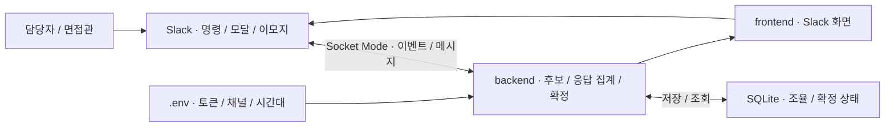

# Slack Interview App — Slack 면접 일정 조율

## 소개

**담당자가 면접 후보 시간을 보내고, 면접관이 번호 이모지로 응답하면 모두 가능한 시간을 찾아 주는 Slack 앱입니다.** 후보·면접관·확정 상태는 실행 PC의 SQLite 파일에 보관합니다.

예를 들어 담당자가 다음 주 후보 6개를 보내면 면접관들은 가능한 번호를 모두 누릅니다. 모두 동의한 후보가 표시되면 담당자가 확정합니다. 확정 버튼을 누를 때 최신 응답을 다시 확인합니다.

[주요 기능](#주요-기능) · [아키텍처](#아키텍처) · [기술 스택](#기술-스택) · [처음 실행하기](#처음-실행하기) · [프로젝트 구조](#프로젝트-구조) · [문서 전체 목차](docs/README.md)

## 주요 기능

| 하고 싶은 일 | 사용 방법 |
|---|---|
| 조율 시작 | `/interview` 또는 앱 홈의 새 일정 조율 |
| 면접관·후보 선택 | 다음 주 월~금에서 추천된 후보를 확인하고 최대 10개 전송 |
| 가능한 시간 응답 | 메시지 아래에서 가능한 번호 이모지를 모두 선택 |
| 공통 시간 확인 | 지정한 면접관 모두가 누른 후보에 모두 가능 표시 |
| 일정 확정·취소 | 조율을 시작한 담당자가 확정하거나 확정 취소 |
| 지난 정보 재사용 | 최근 면접관을 기본값으로 사용하고 같은 시작 시각의 확정 후보는 다음 추천에서 제외 |

기본 면접 길이는 60분, 추천 후보는 6개입니다. 후보 전체가 불가능한 응답과 미응답은 구분하지 않으며, 실제 캘린더 예약이나 초대를 생성하지 않습니다. 자세한 화면 순서는 [상세 사용법](docs/USAGE.md#현재-구현과-화면-흐름)을 참고하세요.

## 아키텍처

화면·업무 처리·저장이 어떤 역할을 맡는지 보여 주는 구성도입니다.



Socket Mode는 **앱이 Slack으로 연결을 열어 명령과 이벤트를 받는 방식**입니다. 공개 웹 수신 서버나 도메인 없이 사용할 수 있으며, 실행 PC에서 Slack으로 나가는 인터넷 연결이 필요합니다. 면접관은 Slack 안에서만 응답합니다.

투표 원본은 Slack의 이모지 반응입니다. SQLite에는 면접관·후보·확정 상태를 저장하고, 반응 이벤트가 오면 Slack에서 반응을 다시 읽어 집계합니다.

## 기술 스택

| 구분 | 기술 | 맡은 역할 |
|---|---|---|
| 실행 | Node.js 22.13 이상 · npm | 앱 실행과 잠금 파일 기준 의존성 설치 |
| Slack 연결 | Slack Bolt | 명령·버튼·이모지 이벤트 수신과 메시지 전송 |
| 화면 | Slack Block Kit | 앱 홈·후보 선택 모달·조율 메시지 표시 |
| 저장 | Node.js 내장 SQLite | 조율과 확정 상태 보관 |
| 설정 | Node.js 환경 파일 로더 | 루트 .env의 토큰·채널·시간 설정 읽기 |

새 설치는 Node.js 24를 사용할 수 있습니다. 별도 DB 서버나 AI API 키가 필요하지 않습니다. 패키지 버전은 [package.json](package.json)과 [package-lock.json](package-lock.json)이 기준입니다.

## 처음 실행하기

준비물은 **Node.js 22.13 이상·npm 9.6.4 이상**, **Git**, 앱을 설치할 수 있는 **Slack 워크스페이스 권한**, 쓰기 가능한 로컬 디스크입니다. 프로그램과 권한의 전체 목록은 [설치 요구사항](docs/REQUIREMENTS.md)에 있습니다.

```sh
git clone https://github.com/realmi-lab/slack-interview-app.git
cd slack-interview-app
npm ci
cp .env.example .env
```

Windows PowerShell에서는 `cp` 대신 `Copy-Item .env.example .env`를 사용할 수 있습니다.

1. [manifest.json](manifest.json)으로 Slack 앱을 만들고 워크스페이스에 설치합니다.
2. Socket Mode를 켜고, 봇 토큰과 `connections:write` 앱 토큰을 `.env`에 입력합니다.
3. 게시할 채널에 봇을 초대하고 `SLACK_NOTIFY_CHANNEL`에 채널 ID를 입력합니다.
4. 설정을 검사한 뒤 실행합니다.

```sh
npm run doctor
npm start
```

실행 로그의 `Slack 연결 완료 · 면접 일정 조율 봇`을 확인하고 Slack에서 `/interview`를 입력합니다. 실행 PC와 봇 프로세스가 켜져 있어야 새 응답을 처리합니다. 앱 생성 화면과 권한·이벤트는 [설치 상세](docs/USAGE.md#설치와-slack-연결)를 보세요.

## 두 앱의 공통 설정

[회의실 앱](https://github.com/realmi-lab/slack_qr_check)과 같은 설정 이름·읽기 순서·Slack 연결 구조를 사용합니다.

```dotenv
SLACK_BOT_TOKEN=
SLACK_APP_TOKEN=
SLACK_NOTIFY_CHANNEL=
APP_TIMEZONE=Asia/Seoul
SQLITE_PATH=./data/availability.sqlite
```

실행 환경변수가 루트 `.env`보다 우선합니다. `SLACK_NOTIFY_CHANNEL`은 면접 앱의 앱 홈에서 시작한 조율을 게시할 채널로 필수입니다. 각 앱의 토큰과 DB는 따로 사용합니다. [공통 설정 안내](docs/SLACK_SETUP.md)와 [.env.example](.env.example)을 기준으로 입력하세요.

면접 앱의 추가 설정은 다음과 같습니다.

| 설정 | 기본값 | 뜻 |
|---|---|---|
| `START_HOUR`, `END_HOUR` | 10, 18 | 후보를 만들 하루 시작·종료 시각 |
| `INTERVIEW_MINUTES` | 60 | 면접 길이와 후보 시작 간격 |
| `OPTION_COUNT` | 6 | 미리 선택하는 추천 후보 수. 최대 10 |

12:30~14:00 점심과 겹치는 후보는 제외합니다. 30분 단위 예시와 이전 `config.json`·Mac 키체인 사용법은 [설정 상세](docs/USAGE.md#시간과-후보-설정)를 참고하세요. 새 설치에는 `.env`만 있으면 됩니다.

## 업데이트·종료·백업

실행 중인 터미널에서 `Ctrl+C`로 종료한 뒤 업데이트합니다.

```sh
git pull --ff-only origin main
npm ci
npm start
```

로컬 수정이 있거나 Git이 충돌을 알리면 강제로 덮어쓰지 않습니다. `.env`와 SQLite 파일을 보존하세요. 백업·복원은 프로세스를 종료한 상태에서 `SQLITE_PATH` 파일을 복사하는 방식입니다. [운영 안내](docs/USAGE.md#실행과-운영)에 상세 절차가 있습니다.

## 프로젝트 구조

```text
backend/       설정·Slack 연결·후보 계산·확정·SQLite
frontend/      Slack 홈·모달·메시지 화면
tools/         설정 검사·선택형 Mac 키체인 도구
tests/         후보·투표·확정·저장·설정 회귀 검사
docs/          공통 설정·상세 사용·검증 기록
.env.example   공개 가능한 설정 예제
```

| 수정할 내용 | 시작할 파일 |
|---|---|
| 환경변수·Slack 연결 | [backend/config.mjs](backend/config.mjs), [backend/slack.mjs](backend/slack.mjs) |
| 명령·버튼 이벤트 | [backend/app.mjs](backend/app.mjs) |
| 후보 계산·투표 집계 | [backend/core.mjs](backend/core.mjs) |
| 확정 권한·최신 투표 검사 | [backend/confirmation.mjs](backend/confirmation.mjs) |
| Slack 화면·저장 | [frontend/blocks.mjs](frontend/blocks.mjs), [backend/store.mjs](backend/store.mjs) |

다른 개발자·GPT의 작업 기준은 [AGENTS.md](AGENTS.md)를 따릅니다.

## 검증과 현재 한계

핵심 회귀 검사는 다음 명령으로 한 번 실행합니다.

```sh
npm test
```

2026-11-10 코드 변경 검증에서 **9개 검사와 Linux CI가 통과**했습니다. 메모리 SQLite와 가상 Slack 값을 사용했으며, 실제 워크스페이스의 토큰·권한·이모지 이벤트를 모두 검증한 결과는 아닙니다. 검사 범위와 근거는 [검증 기록](docs/TEST_REPORT.md)에 정리했습니다.

캘린더 연동·개인별 시간 충돌 검사·전체 불가 응답·누락 이벤트 복구는 구현하지 않았습니다. 앱이 중단된 동안의 응답이나 확정 후 바뀐 투표를 자동으로 복구·취소하지 않습니다. 자세한 제한은 [현재 한계](docs/USAGE.md#현재-제한과-확장-방향)를 보세요.

## 문서와 참고 자료

[문서 전체 목차](docs/README.md) · [설치 요구사항](docs/REQUIREMENTS.md) · [상세 사용·운영](docs/USAGE.md) · [Slack 공통 설정](docs/SLACK_SETUP.md)

README 구성은 [Code Management](https://github.com/realmi-lab/code_management#readme)의 소개·기능·구성도·기술 역할·실행 입구·검증 구분 방식을 참고했습니다. Slack 연결 방식은 [Socket Mode 공식 문서](https://docs.slack.dev/apis/events-api/using-socket-mode/)를 참고하세요.
