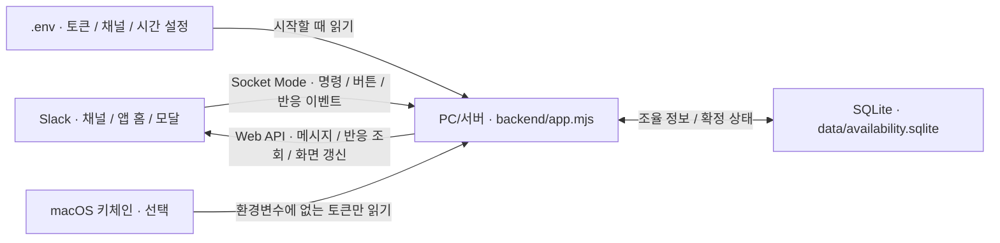

# 면접 일정 Slack 앱

두 앱의 공통 설정·설치 흐름은 [Slack 공통 설정](docs/SLACK_SETUP.md)을 따릅니다.

면접관에게 각각 전화해 가능한 시간을 묻는 과정을 Slack 채널의 일정 조율 메시지 하나로 모으는 앱입니다. 담당자가 후보 시간을 보내면 면접관이 번호 이모지로 응답하고, 모두 가능한 시간을 담당자가 확정합니다.

이 문서는 프로젝트 배경, 현재 구현, 사용법, 설치, 설정, 데이터 구조, 운영 방법과 제한을 한곳에 정리합니다. **2026-11-06 공개 소스 기준**이며 실제 운영 설정과 개인 데이터는 포함하지 않습니다.

## 1. 만든 배경

처음 해결하려던 문제는 면접관 3명에게 각각 연락해 가능한 날짜와 시간을 확인하고, 공통 시간을 다시 맞추는 반복 작업이었습니다. 다음 조건에서 Slack으로 응답을 모으는 흐름을 검토했습니다.

- 월~금, 오전 10시부터 가능한 시간을 받는다.
- 점심시간인 12:30~14:00은 제외한다.
- 30분 단위로 가능 시간을 여러 개 선택할 수 있어야 한다.
- 모바일에서 조작이 간단하고, 결과를 일정 조율 채널에서 함께 확인할 수 있어야 한다.
- 개인 도메인이나 외부 공개 HTTPS 주소를 새로 운영하지 않는다.
- Slack 사용자와 조율 상태를 연결하고, 확정·취소 상태를 SQLite에 저장한다.

초기에는 월~금 전체를 30분 칸으로 표시하는 주간표와 HTML 화면을 검토했습니다. 10:00~18:00에서 점심을 빼면 하루 13칸, 한 주 65칸이 됩니다. 이 표를 모바일에서 하나씩 조작하는 부담과 별도 웹 화면 연결 문제를 줄이기 위해, 현재 공개 버전은 **담당자가 후보를 추리고 면접관은 번호 이모지만 누르는 방식**으로 구성했습니다.

현재 구현은 한 주의 모든 칸에 개인별 가능·불가를 기록하는 시간표가 아니라, **조율 메시지마다 최대 10개의 후보에 가능 응답을 모으는 방식**입니다. 기본 면접 길이는 60분이며, 아래 설정에서 30분으로 바꿀 수 있습니다.

## 2. 현재 구현과 화면 흐름

| 단계 | 담당자 | 면접관 | 앱 처리 |
| --- | --- | --- | --- |
| 조율 시작 | `/interview` 또는 앱 홈의 **새 일정 조율** | — | 다음 주 월~금 후보를 생성한다. |
| 후보 보내기 | 면접관과 후보 시간을 확인하고 **보내기** | — | 채널에 멘션·후보 목록·번호 이모지를 올린다. |
| 응답 | 같은 메시지에서 진행 상태 확인 | 가능한 시간의 번호 이모지를 모두 누른다. | 지정된 면접관의 반응만 집계하고 원래 메시지를 갱신한다. |
| 공통 시간 확인 | **모두 가능** 표시 확인 | 이모지를 눌러 응답을 수정할 수 있다. | 모든 면접관이 누른 후보를 표시한다. |
| 확정 | 원하는 후보의 **확정** 클릭 | 스레드 알림 확인 | 확정 상태를 SQLite에 저장하고 스레드로 알린다. |
| 확정 취소 | **확정 취소** 클릭 | 스레드 알림 확인 | 저장된 확정값을 비우고 스레드로 알린다. |

### 담당자 사용법

1. 봇이 참여한 채널에서 `/interview`를 입력합니다. 앱 홈에서 **새 일정 조율**을 눌러도 됩니다.
2. 면접관을 선택합니다. 가장 최근에 같은 워크스페이스에서 조율한 면접관이 기본값으로 들어갑니다. 인원이 3명으로 고정된 것은 아닙니다.
3. 후보 시간을 확인합니다. 기본으로 한 주에 고르게 분산한 6개가 선택되며, 최대 10개까지 바꿀 수 있습니다.
4. **보내기**를 누릅니다. 명령어로 시작했다면 그 대화에, 앱 홈에서 시작했다면 `notificationChannelId`의 채널에 올라갑니다.
5. 공통으로 가능한 후보가 나타나면 **확정**을 누릅니다. 확정과 확정 취소는 그 조율을 시작한 담당자만 할 수 있습니다.

### 면접관 사용법

1. 채널의 조율 메시지에서 자신이 멘션됐는지 확인합니다.
2. 후보 앞의 번호와 같은 이모지를 메시지 아래에서 누릅니다. 가능한 시간이 여러 개면 여러 번호를 눌러도 됩니다.
3. 잘못 누른 번호는 다시 눌러 자신의 반응을 제거합니다.

봇이 미리 달아 둔 이모지의 숫자에는 봇 반응도 포함됩니다. 앱은 그 숫자 자체를 참석자 수로 사용하지 않고, 선택된 면접관의 Slack 사용자 ID를 대조합니다. 반응한 면접관 목록과 앱의 **응답 n/N명** 표시를 확인하세요.

### 집계 예시

다음은 동작 설명을 위한 가상 예시입니다.

| 후보 | 면접관 A | 면접관 B | 면접관 C | 결과 |
| --- | --- | --- | --- | --- |
| 1번 | 가능 | 가능 | 가능 | 모두 가능 |
| 2번 | 가능 | 반응 없음 | 가능 | 공통 후보 아님 |
| 3번 | 반응 없음 | 가능 | 반응 없음 | 공통 후보 아님 |

**응답 완료**는 각 면접관이 적어도 하나의 번호를 눌렀다는 뜻입니다. 모든 후보가 불가능한 사람은 현재 별도 응답 버튼이 없어, 반응하지 않은 사람과 구분할 수 없습니다. 또 모두가 응답해도 공통 후보가 없을 수 있습니다. 이때는 담당자가 후보를 바꿔 새 조율을 시작합니다.

## 3. 공개 HTTPS 주소 없이 연결하는 구조

앱이 Mac에서 Slack으로 Socket Mode 연결을 엽니다. Slack이 접근할 공개 HTTP 수신 서버, 개인 도메인, 포트 포워딩, 터널은 필요하지 않습니다. 다만 Mac에서 Slack으로 나가는 인터넷 연결은 필요합니다. 이 연결 방식은 [Slack Socket Mode 공식 문서](https://docs.slack.dev/apis/events-api/using-socket-mode/)를 따릅니다.



면접관은 Slack에서만 응답합니다. 설치 과정의 `127.0.0.1` 주소는 이 Mac에서 선택형 Mac 키체인 저장 도구를 사용할 때 잠시 여는 입력 화면이며, 면접관에게 배포하는 주소가 아닙니다.

## 4. 설치와 Slack 연결

### 준비물

- Node.js 22.13 이상과 npm 9.6.4 이상, Git. 새 설치는 Node.js 24 LTS를 권장합니다. macOS·Linux·Windows에서 `.env`로 실행합니다.
- 쓰기 가능한 로컬 디스크(SQLite)와 계속 켜 둘 PC/서버. 외부 DB·AI 키·캘린더 계정·공개 도메인은 필요하지 않습니다.
- Mac 키체인을 선택할 때만 Swift/Xcode Command Line Tools가 필요합니다.
- 대상 Slack 워크스페이스에 앱을 만들고 설치할 수 있는 권한.
- 봇이 참여할 채널과 그 채널의 ID. 비공개 채널도 봇을 초대해 사용합니다.

토큰은 실행 환경변수 또는 저장소의 `.env`에서 읽습니다. 기본 우선순위는 **실행 환경변수 → .env → 기본값**입니다. Mac 키체인은 `SLACK_TOKEN_SOURCE=keychain`을 명시했을 때만 환경변수에 없는 토큰을 읽습니다. `config.json`은 기존 설치 호환용이며 새 설치에는 필요하지 않습니다. `SQLITE_PATH`는 기본 `./data/availability.sqlite`이며 상대 경로는 저장소 루트 기준입니다.

### 4-1. 소스 받기

```sh
git clone https://github.com/realmi-lab/slack-interview-app.git
cd slack-interview-app
npm ci
cp .env.example .env
# Windows PowerShell: Copy-Item .env.example .env
```

`.env`에 아래 값을 입력하세요. 토큰 두 개와 봇을 초대한 채널 ID가 필수이며, 나머지는 운영 시간 설정입니다. Linux/macOS에서는 `chmod 600 .env`를 실행하세요.

```dotenv
SLACK_BOT_TOKEN=여기에_봇_토큰
SLACK_APP_TOKEN=여기에_앱_토큰
SLACK_NOTIFY_CHANNEL=C0123456789
APP_TIMEZONE=Asia/Seoul
START_HOUR=10
END_HOUR=18
INTERVIEW_MINUTES=60
OPTION_COUNT=6
```

시간은 정수로 입력합니다. `START_HOUR`는 0~23, `END_HOUR`는 1~24이며 종료가 시작보다 늦어야 합니다. `INTERVIEW_MINUTES`는 1~480, `OPTION_COUNT`는 1~10입니다. 점심을 제외한 후보가 하나도 없으면 시작을 거절합니다. Slack 토큰·채널은 아래 단계에서 준비합니다.

### 4-2. Slack 앱 만들기

1. [Slack 앱 관리](https://api.slack.com/apps)에서 **Create New App → From a manifest**를 선택합니다.
2. 사용할 워크스페이스를 선택하고 이 저장소의 [`manifest.json`](manifest.json)을 붙여 넣어 앱을 생성합니다.
3. 워크스페이스에 앱을 설치하고 **Bot User OAuth Token**을 준비합니다. 봇 토큰의 접두사는 `xoxb-`입니다.
4. **Socket Mode**가 켜져 있는지 확인합니다.
5. **Basic Information → App-Level Tokens**에서 `connections:write` 권한의 앱 토큰을 만듭니다. 앱 토큰의 접두사는 `xapp-`입니다.
6. 사용할 채널에 `/invite @interview-scheduler`로 봇을 초대합니다. 앱 표시 이름을 바꿨다면 변경한 이름을 사용합니다.

매니페스트로 앱을 만드는 절차는 [Slack App manifests 공식 문서](https://docs.slack.dev/app-manifests/)에서 확인할 수 있습니다. 권한을 나중에 바꿨다면 워크스페이스에 다시 설치하고 유효한 봇 토큰을 사용하세요.

### 4-3. .env 설정 확인 · Mac 키체인은 선택

기본 설치는 `.env`에 `SLACK_BOT_TOKEN`, `SLACK_APP_TOKEN`, `SLACK_NOTIFY_CHANNEL`을 입력하면 끝입니다. 다음 명령은 설정 형식·토큰 존재·내장 SQLite를 검사하며 Slack으로 연결하거나 메시지를 보내지 않습니다.

```sh
npm run doctor
npm start
```

`doctor` 오류는 종료 코드 1입니다. 토큰이 유효한지와 권한·채널 참여 여부는 실제 Slack 연결 후 확인해야 합니다. `.env`와 운영 DB는 Git에서 제외되며 `.env.example`만 공개됩니다.

Mac 키체인을 선호하는 기존 사용자는 `.env`에 `SLACK_TOKEN_SOURCE=keychain`을 적고 토큰을 비운 뒤 다음 선택 절차를 사용할 수 있습니다. 기본 설치에서는 이 절차가 필요하지 않습니다.

```sh
xcrun swiftc tools/keychain-save.swift -o tools/keychain-save
node tools/keychain-setup.mjs
```

터미널에 표시된 `http://127.0.0.1:.../setup/...` 주소를 같은 Mac의 브라우저에서 엽니다. 봇 토큰과 앱 토큰을 입력하고 **Mac 키체인에 저장**을 누릅니다. macOS가 키체인 접근을 요청하면 이 Mac에서 직접 승인합니다.

| 키체인 서비스 이름 | 저장하는 값 | 용도 |
| --- | --- | --- |
| `slack-interview-bot-token` | 봇 토큰 | 메시지·반응·앱 화면 API 호출 |
| `slack-interview-app-token` | 앱 토큰 | Socket Mode 연결 |

입력 서버는 `127.0.0.1`에만 연결되며 저장을 마치거나 10분이 지나면 닫힙니다. 토큰은 저장 도구의 표준 입력으로 전달합니다. 소스, `config.json`, Git, 명령행 인수에 실제 토큰을 넣지 마세요.

### 4-4. 권한과 이벤트 확인

| 종류 | 이름 | 용도 |
| --- | --- | --- |
| 봇 권한 | `commands` | `/interview` 실행 |
| 봇 권한 | `chat:write` | 조율 메시지·스레드·안내 메시지 전송과 갱신 |
| 봇 권한 | `reactions:read` | 조율 메시지의 이모지 반응 조회 |
| 봇 권한 | `reactions:write` | 번호 이모지를 메시지에 미리 추가 |
| 앱 토큰 권한 | `connections:write` | Socket Mode 연결 생성 |
| 봇 이벤트 | `app_home_opened` | 앱 홈 표시 |
| 봇 이벤트 | `reaction_added`, `reaction_removed` | 가능 응답 변경 감지 |

슬래시 명령과 Interactivity도 매니페스트에 들어 있습니다. Socket Mode로 처리하므로 별도의 공개 Request URL을 준비하지 않습니다.

## 5. 시간과 후보 설정

기본 [`config.example.json`](config.example.json)은 다음과 같습니다. 새 설치는 `.env`만 사용하세요. 기존 `config.json`도 읽으며 같은 항목의 환경변수가 있으면 환경변수가 우선합니다.

```json
{
  "notificationChannelId": "",
  "startHour": 10,
  "endHour": 18,
  "interviewMinutes": 60,
  "optionCount": 6
}
```

| config.json 키 (선택) | 뜻 | 설정 기준 |
| --- | --- | --- |
| `notificationChannelId` | 앱 홈에서 시작할 때 메시지를 올릴 채널 | 봇이 참여한 실제 채널의 ID를 입력한다. |
| `startHour` | 하루 후보 시작 시각 | 기본 10시. |
| `endHour` | 하루 후보 종료 시각 | 기본 18시. 면접 종료가 이 시각을 넘는 후보는 만들지 않는다. |
| `interviewMinutes` | 면접 길이이자 후보 시작 간격 | 기본 60분. 30분 후보가 필요하면 30으로 설정한다. |
| `optionCount` | 미리 선택해 두는 추천 후보 수 | 1~10의 정수로 설정한다. 보낼 후보도 최대 10개다. |

점심시간 12:30~14:00과 조금이라도 겹치는 후보는 제외합니다. 점심시간과 대상 요일은 현재 `backend/core.mjs`에 정의되어 있으며 설정 파일로 바꾸는 항목은 아닙니다.

### 30분 단위로 쓰기

`.env`에서 `INTERVIEW_MINUTES=30`으로 바꾸고 프로세스를 재시작합니다. 다른 기본값을 유지하면 생성 결과는 다음과 같습니다.

| 설정 | 오전 | 오후 | 하루 / 한 주 후보 수 |
| --- | --- | --- | --- |
| 기본 60분 | 10:00, 11:00 시작 | 14:00부터 17:00까지 매시 시작 | 6개 / 30개 |
| 30분 | 10:00부터 12:00까지 30분 간격 | 14:00부터 17:30까지 30분 간격 | 13개 / 65개 |

**생성된 65개 전체 중 한 조율에 보낼 수 있는 후보는 최대 10개입니다.** 이 설정이 65칸짜리 개인 시간표 입력 화면을 추가하는 것은 아닙니다. 면접 길이와 후보 시작 간격을 각각 다르게 지정하는 기능도 없습니다.

대상 주간은 실행 시점의 다음 월요일부터 금요일입니다. 월요일에 실행해도 다음 주 월요일이 대상입니다. 임의 날짜나 이번 주를 고르는 입력은 없습니다. `nextMonday()`가 실행 환경의 로컬 날짜를 사용하므로 한국 시간으로 운영하려면 실행 환경의 시간대를 맞춥니다.

## 6. 실행과 운영

### 실행·종료

한국 시간으로 실행하는 예입니다.

```sh
npm run doctor
npm start
```

`Slack 연결 완료 · 면접 일정 조율 봇`이 출력되는지 확인합니다. 종료는 실행 중인 터미널에서 `Ctrl+C`를 누릅니다. `.env`의 `APP_TIMEZONE=Asia/Seoul`도 로드됩니다. 설정을 바꾸면 종료한 뒤 다시 실행합니다.

Mac이 켜져 있고 프로세스가 실행 중이어야 명령과 응답을 처리합니다. 잠자기·네트워크 단절·프로세스 종료 중에는 응답 처리가 지연되거나 누락될 수 있습니다. 재부팅 후 자동 실행, 별도 상태 확인 HTTP API, 중단 중 누락 이벤트 재집계 기능은 구현하지 않았습니다.

Finder의 `restart.command`로도 재시작할 수 있습니다. 이 파일은 이름이 `backend/app.mjs`인 프로세스를 찾아 종료하므로, 같은 Mac에서 복사본을 여러 개 운영할 때는 각 터미널에서 대상 프로세스를 직접 종료하고 실행하세요.

### 데이터 백업·복원

프로세스를 정상 종료한 뒤 `SQLITE_PATH` 파일(기본 `data/availability.sqlite`)을 비공개 위치에 복사해 백업합니다. 복원할 때도 프로세스를 종료하고 해당 파일을 되돌린 다음 실행합니다. `.env`, 선택형 키체인 토큰·`config.json`은 DB와 별도입니다. `.env`도 비공개로 백업하세요.

DB를 복원해도 삭제된 Slack 메시지나 제거된 이모지 반응이 되살아나지는 않습니다. 반대로 DB를 잃으면 Slack에 메시지가 남아 있어도 그 메시지를 기존 조율로 처리할 수 없습니다.

## 7. 데이터와 코드 구조

SQLite에는 `polls` 테이블을 사용합니다. 채널 ID와 메시지 타임스탬프를 묶어 조율을 구분합니다.

| 필드 | 내용 |
| --- | --- |
| `channel`, `ts` | 조율 메시지가 있는 채널과 메시지 식별값. 두 값이 기본 키다. |
| `team` | Slack 워크스페이스 ID |
| `organizer` | 조율을 시작한 Slack 사용자 ID |
| `interviewers` | 면접관 Slack 사용자 ID 목록(JSON) |
| `options` | 후보의 날짜·시작 시각 ID와 표시 문구(JSON) |
| `confirmed` | 확정한 후보 번호. 확정 전이나 확정 취소 후에는 `NULL` |
| `notified` | 모든 면접관이 한 번 이상 반응했다는 알림을 보냈는지 여부 |
| `created_at` | 조율 생성 시각 |

**면접관별 투표 원본은 SQLite에 저장하지 않습니다.** 번호 반응 이벤트가 오면 Slack에서 그 메시지와 반응을 조회해 다시 계산합니다. 별도의 개인별 가용 시간 테이블, 예약 취소 이력 테이블, 캘린더 예약 레코드는 없습니다. 확정 취소는 `confirmed`를 비우는 동작이며, 안내 메시지는 Slack 스레드에 남습니다.

| 파일 | 역할 |
| --- | --- |
| [`backend/app.mjs`](backend/app.mjs) | 설정·키체인 읽기, Slack 연결, 명령·모달·이모지·확정 처리 |
| [`backend/core.mjs`](backend/core.mjs) | 날짜·후보 계산, 추천, 반응 집계, 공통 후보 계산 |
| [`frontend/blocks.mjs`](frontend/blocks.mjs) | 앱 홈, 조율 모달, 메시지와 버튼 생성 |
| [`backend/store.mjs`](backend/store.mjs) | SQLite 조율 정보와 확정 상태 저장 |
| [`manifest.json`](manifest.json) | Slack 앱 권한·이벤트·명령 설정 |
| [`config.example.json`](config.example.json) | 개인 설정을 제외한 설정 예시 |
| [`tools/keychain-setup.mjs`](tools/keychain-setup.mjs) | 같은 Mac에서만 여는 토큰 입력 화면 |
| [`tools/keychain-save.swift`](tools/keychain-save.swift) | 입력받은 토큰을 macOS 키체인에 저장 |
| [`tests/`](tests/) | 날짜·후보·집계·저장소·화면 구성 테스트 |
| [`restart.command`](restart.command) | 로컬 재시작 보조 스크립트 |

`.gitignore`는 실제 설정, DB, 로그, 운영 상태, 이전 백업, 키체인 저장 도구의 빌드 결과를 제외합니다. 이 자료는 공개 저장소에 추가하지 않습니다.

## 8. 현재 제한과 확장 방향

다음은 현재 코드에서 구분해야 할 동작입니다.

- **불가와 미응답 구분:** 번호를 누르지 않은 이유는 알 수 없습니다. 후보 전체 불가·응답 완료 버튼이나 미응답자 재알림은 없습니다.
- **응답 완료 알림:** 모든 면접관이 적어도 하나의 번호를 누르면 조율당 한 번 보냅니다. 이후 반응을 제거했다가 다시 눌러도 완료 알림을 다시 보내지 않습니다.
- **확정 후 변경:** 면접관이 반응을 바꿔도 이미 저장한 확정 상태를 자동으로 취소하지 않습니다.
- **중복 회피 범위:** 같은 워크스페이스의 기존 확정 후보와 날짜·시작 시각 ID가 동일한 후보를 다음 추천에서 제외합니다. 면접관별 충돌 검사나 시간 구간의 겹침 검사가 아닙니다. 기존 조율의 후보 목록을 소급 변경하지도 않습니다.
- **실제 캘린더:** Google Calendar·Outlook 일정 조회, 초대 발송, 실제 캘린더 예약 생성은 없습니다.
- **모바일 확인:** Slack 기본 화면을 사용하지만 iPhone 17 실기기에서 한 화면에 모든 후보가 보이는지는 검증하지 않았습니다.
- **규모와 복구:** 소규모 면접관 조율을 대상으로 합니다. Slack의 반응 조회 응답은 모든 반응자의 ID를 포함한다고 보장되지 않으므로 대규모 투표의 정확성까지 보장하지 않습니다. 자세한 반환 조건은 [reactions.get 공식 문서](https://docs.slack.dev/reference/methods/reactions.get/)를 참고하세요.

향후 캘린더를 연동하려면 `openPollModal()`의 후보 생성 단계에 면접관별 일정의 겹침 검사를 추가해야 합니다. 현재 `busy()`는 기존 확정 후보의 시작 시각 ID만 반환하므로, 캘린더 일정을 그 목록에 더하는 것만으로 일반적인 시간 충돌 검사가 완성되지는 않습니다. 개인별 불가 응답, 취소 이력, 중단 후 재집계도 별도 구현 대상입니다.

## 9. 자주 생기는 문제

| 증상 | 확인할 내용 |
| --- | --- |
| `/interview`가 반응하지 않음 | Mac의 봇 프로세스·네트워크, 앱 설치, Socket Mode, `commands` 권한을 확인한다. |
| 모달에서 채널에 올릴 수 없다고 나옴 | 해당 채널에 봇을 초대했는지, 앱 홈이라면 `notificationChannelId`가 맞는지 확인한다. |
| 이모지를 눌러도 결과가 바뀌지 않음 | `reaction_added`·`reaction_removed` 이벤트와 `reactions:read` 권한, 봇 실행 상태를 확인한다. |
| 번호 이모지가 미리 달리지 않음 | `reactions:write` 권한과 실행 로그를 확인한다. 메시지만 게시되고 뒤의 반응 추가가 실패했을 수 있다. |
| `missing_scope` 또는 인증 오류 | Slack 앱 권한과 재설치 상태를 확인하고 필요한 경우 키체인에 유효한 토큰을 다시 저장한다. |
| 시작할 때 키체인 조회 실패 | 두 서비스 이름과 저장 여부를 확인하고 Mac의 키체인 접근 요청을 직접 처리한다. |
| `swiftc`를 찾을 수 없음 | Xcode Command Line Tools와 Swift 컴파일러 설치를 확인한다. |
| 공통 가능한 시간이 없음 | 응답자 목록과 후보를 확인한다. 모두 응답했어도 공통 시간이 없으면 새 후보로 조율한다. |
| 실행 이후에도 지난 조율 결과가 오래된 상태임 | 새 반응 이벤트가 없는 조율을 시작 시 일괄 재조회하는 기능은 없다. 담당자가 반응을 확인한다. |

게시 결과나 오류가 불확실할 때는 채널에 메시지가 이미 올라갔는지 먼저 확인하세요. 이 버전에는 전송 결과 감사 기록이나 수동 복구 화면이 없습니다.

## 10. 검증 방법

```sh
npm test
```

핵심 테스트 9개는 다음 주·후보 계산, 반응 집계, 확정·취소 저장, 확정 시 권한·최신 투표 검증과 .env 설정을 다룹니다. 화면 문구 고정 테스트는 제외합니다. 메모리 SQLite와 가상 Slack 사용자 값을 사용합니다.

테스트 통과는 실제 워크스페이스 설치, 실제 이모지 이벤트 수신, 채널 전달, 모바일 화면 검증을 대신하지 않습니다. 이 문서 업데이트에서는 소스와 매니페스트를 대조하고 기본 60분·선택 가능한 30분 설정의 후보 수를 확인했습니다.

## 새 설치 검증과 의존성 관리

```sh
node --version
npm ci
npm test
npm run doctor
npm start
```

`package-lock.json`을 함께 배포해 `npm ci`로 동일 버전을 설치합니다. 2026-11-10 npm 레지스트리 기준 `@slack/bolt` 최신 5.1.0을 유지하고 lock의 간접 의존성을 점검했습니다. `npm audit --omit=dev`에서 알려진 취약점은 0건이었습니다. 설치 시점 이후에는 재확인이 필요합니다. [Node.js 환경 파일 문서](https://nodejs.org/api/process.html#processloadenvfilepath)를 참고하세요.

CI는 Linux에서 Node.js 24로 `npm ci` 및 테스트를 실행합니다. 로컬 검사는 토큰 없는 환경에서 수행하며 실제 Slack 이벤트·워크스페이스 설치 완료를 의미하지 않습니다. 설치 후 `/interview` → 후보 게시 → 면접관 이모지 응답 → 담당자 확정·취소까지 자신의 워크스페이스에서 확인하세요.

설치 검증(2026-11-10): `.env`만 있고 `config.json`은 없는 새 프로세스의 설정 로딩·시간대 적용을 포함해 로컬 핵심 테스트 9개를 유지합니다. OS·Node 버전 조합을 매번 반복하지 않습니다. `npm run doctor`는 비밀값을 출력하지 않습니다.

## 폴더와 수정 위치

```text
backend/
  app.mjs          Slack 명령·이벤트 연결과 실행
  core.mjs         날짜·후보 생성·투표 집계
  confirmation.mjs 확정 권한·최신 투표 검증
  config.mjs       .env·시간대·DB 경로·선택형 config.json
  slack.mjs        토큰 확인·Socket Mode 연결
  store.mjs        SQLite 저장
frontend/
  blocks.mjs       앱 홈·모달·메시지 화면
tests/             핵심 회귀 검사
tools/             설정 검사·선택형 키체인 도구
```

화면 변경은 frontend, 규칙·설정·저장은 backend에서 시작하세요. 프론트엔드는 Slack Block Kit 화면이며 별도 웹 빌드나 프론트 서버가 없습니다. `npm start`와 루트 `.env`·`data/availability.sqlite` 위치는 유지합니다. 오래된 확정 버튼은 클릭 시 최신 응답을 다시 확인하며, 전원 동의가 사라진 후보와 범위 밖 후보를 저장하지 않습니다.
